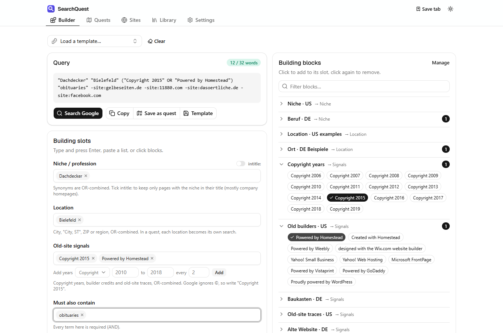
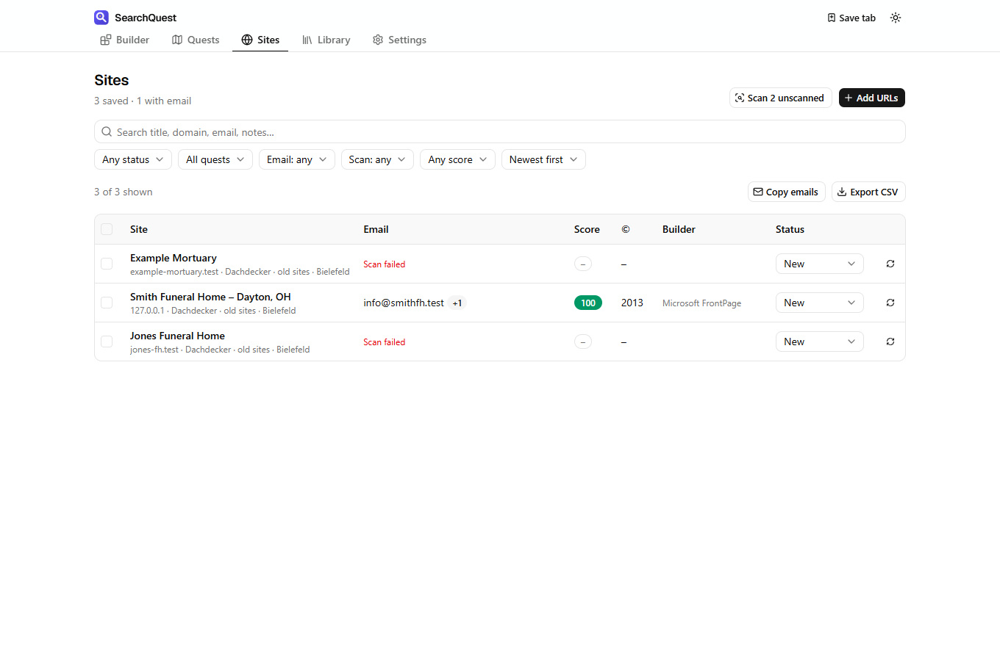
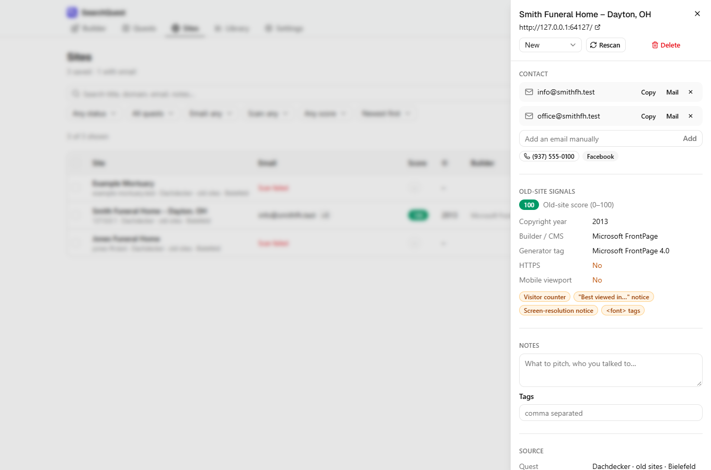
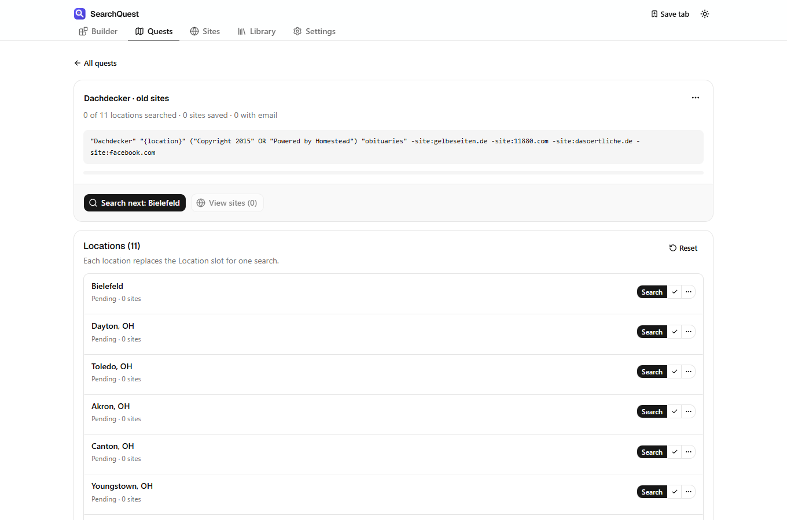
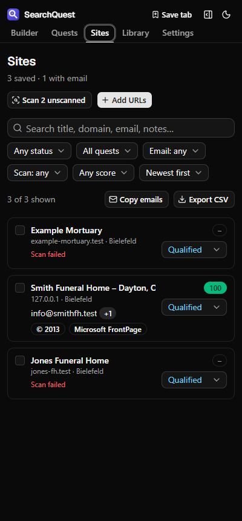
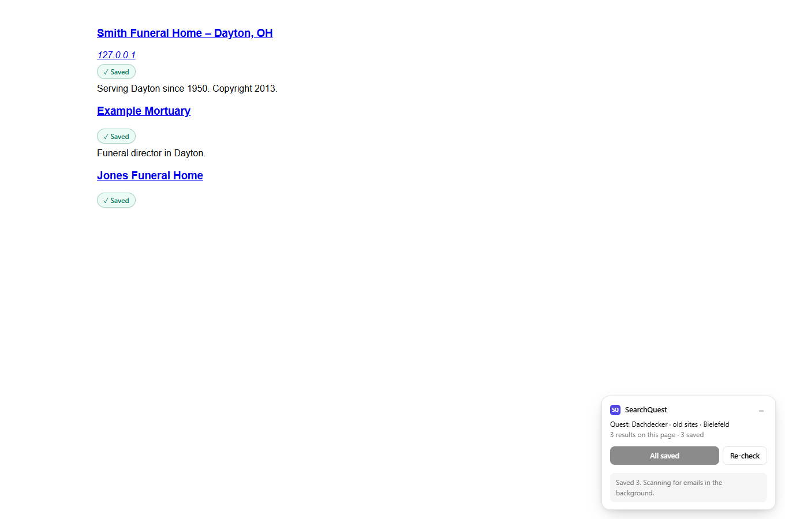

# SearchQuest

A Chrome extension for finding small businesses with outdated websites through Google search operators. It saves the sites it finds and pulls their contact details.

- **Builder.** Assemble queries from building blocks (niche, location, old-site signals, exclusions) or start from a template. A live word meter warns before you go past Google's ~32-word limit.
- **Quests.** Save a query with a list of cities, ZIP codes or regions and run one search per location. The quest remembers which ones you already searched.
- **Save from Google.** Every organic result gets a `+ Save` button, and a floating bar adds "Save all new". Sites saved from a quest's search are tagged with that quest and location.
- **Scan sites.** Each saved site's homepage plus its imprint, contact and about pages are fetched in the background to extract **emails** (including `[at]`/`(at)` obfuscation and Cloudflare-protected addresses), phone numbers, social links, the copyright year, the site builder or CMS, HTTPS, mobile viewport and old-site traces (visitor counters, guestbooks, Flash, framesets, "best viewed in…"). Together these give an **old-site score** from 0 to 100.
- **Manage leads.** Filter, sort, tag, take notes, set a status (new → qualified → contacted → replied → won / rejected), copy emails and export CSV.



| Sites | Site details |
| --- | --- |
|  |  |

| Quest | Side panel (dark) | On Google |
| --- | --- | --- |
|  |  |  |

## Install

**Option A: prebuilt (no Node needed)**

1. Download `search-quest-<version>.zip` from the [latest release](https://github.com/olemaide/search-quest/releases/latest) and unzip it into a folder you'll keep.
2. Open `chrome://extensions` and switch on **Developer mode** (top right).
3. Click **Load unpacked** and pick the unzipped folder (the one containing `manifest.json`).

**Option B: build from source**

```bash
git clone https://github.com/olemaide/search-quest
cd search-quest
npm install
npm run build        # outputs the extension to dist/
```

Then **Load unpacked** → pick the **`dist`** folder. After pulling updates, run `npm run build` again and click the reload icon on the extension's card.

Pin the extension. Clicking its icon opens SearchQuest in the **side panel**; the panel icon in its header opens the full-page view.

## How to use it

1. **Builder.** Pick a template such as *Funeral homes · old copyright* or *Dachdecker · volle Kombination*, or click blocks in the palette. Click **Search Google** for a one-off search.
2. **Save as quest.** Add locations, one per line, or a ready-made city list (US Midwest & South, Ohio, Ostwestfalen-Lippe, Münsterland). The query's location slot is swapped for each location in turn.
3. **Search next.** This opens Google for the next pending location. On the results page, click **+ Save** on promising results or **Save all new**.
4. **Sites.** Scans run automatically. Sort by *Old-site score*, filter on *Has email*, open a site for details, set its status, then **Copy emails** or **Export CSV**.

You can also save the page in the current tab (**+ Save tab**), right-click any page or link → *Save … to SearchQuest*, or paste a list of URLs (**Sites → + Add URLs**).

### Query cheat sheet

| Goal | Example |
| --- | --- |
| Old copyright year (Google ignores ©) | `"Copyright 2014"` |
| Several years at once | `("Copyright 2012" OR "Copyright 2014" OR "Copyright 2016")` |
| Old builders (US) | `"Powered by Homestead"`, `"Powered by Weebly"`, `"Yahoo! Small Business"`, `"Microsoft FrontPage"` |
| Old builders (DE) | `"Erstellt mit Jimdo"`, `"STRATO Homepage-Baukasten"`, `"Erstellt mit Zeta Producer"`, `"NetObjects Fusion"` |
| Very old traces | `"you are visitor number"`, `"sign our guestbook"`, `"Sie sind Besucher Nr"`, `"Gästebuch"` |
| Company homepages only | `intitle:"funeral home"` |
| Location | `"Dayton, OH"`, ZIPs `("45402" OR "45403")`, `"Montgomery County"`, `"Kreis Gütersloh"` |
| Never bought a domain | `site:weebly.com`, `site:wixsite.com`, `site:godaddysites.com` |
| Drop directories | `-site:yelp.com -site:yellowpages.com -site:gelbeseiten.de -site:11880.com` |

Tips:

- Google reads about **32 words** per query, and anything past that is ignored silently. The meter counts for you.
- Mid-sized cities (100k–500k) in the US Midwest and South tend to have the most old sites.
- Industry platforms leave footer credits ("Website by …"). Copy a few from local sites and add them as your own **signal** blocks under *Library → New block*.
- Check each lead yourself. Some sites have a 2015 footer and a modern design.

## Privacy & limits

- All data stays in `chrome.storage.local` in your browser profile. Use *Settings → Export backup* to keep a copy.
- SearchQuest **never runs Google searches automatically**. It opens the searches you click and reads only the results pages you view. A configurable gap between searches (20 s by default) helps you avoid CAPTCHAs, and if Google does show one, the app warns you.
- Site scans are plain GETs of the saved business's own public pages: up to 4 pages per site and 3 sites in parallel by default.
- The extension asks for access to all sites because scanning fetches arbitrary business websites from the background worker.

**Outreach:** US cold email (CAN-SPAM) requires a real sender address and an opt-out. In Germany, UWG §7 generally requires prior consent for advertising email, B2B included. Check the rules for your market before you send. This is not legal advice.

## Development

The UI is **React 19 + [shadcn/ui](https://ui.shadcn.com)** (Radix base, Nova preset, Tailwind CSS v4, Lucide icons, Geist font), built by **Vite**. The service worker, scanner and storage layer are plain JavaScript in `lib/` and are shared by the UI and the worker.

```
public/manifest.json      MV3 manifest (copied to dist/)
public/content/           content script for Google results pages: vanilla JS in a shadow root, styled with shadcn's tokens
background.js             service worker: saves sites, scan queue, context menus (bundled by Vite)
lib/                      query builder, scanner, defaults, storage (plain JS, unit-tested with node:test)
app/app.html, panel.html  entry pages for the full view and the side panel
src/                      React UI
  components/ui/          shadcn/ui components (generated by the shadcn CLI, then owned by this repo)
  components/             theme provider, confirm dialog host, ChipInput, ScoreBadge…
  views/                  Builder, Quests, Sites (table + Sheet), Library, Settings
  hooks/use-ext-data.ts   loads from chrome.storage and re-renders on changes from the worker
```

```bash
npm run dev         # rebuild dist/ on every change (then reload the extension)
npm run build       # type-check + production build
npm test            # 24 unit tests for query building and site scanning
npm run zip         # build + release/search-quest-<version>.zip
npx shadcn@latest add <component>   # add more shadcn components
```

### UI decisions

- **One Vite build, no extension framework.** Two HTML entries (full page + side panel) and the service worker are bundled together. Shared `lib/` code becomes one chunk that the worker imports as an ES module. CRXJS or WXT would add HMR, but they would also add another layer that has to track every Vite release.
- **The side panel and the full page are the same app.** Layout switches on Tailwind **container queries** (`@container/main`), not the viewport. Sites show as a table when there's room and as stacked items in the panel, and the site details open in a `Sheet`.
- **Extension pages are ordinary documents**, so shadcn portals (Dialog, Select, Popover, DropdownMenu, Sonner) work unchanged. There's no shadow-DOM portal-container plumbing.
- **The Google overlay stays vanilla** inside a shadow root and reuses shadcn's neutral tokens. Injecting React and Tailwind into every Google results page would cost about 170 KB gzipped per search. It would also run into the known shadow-DOM problems (rem units resolve against Google's root font size, and portals escape the shadow root).
- **No `next-themes`.** A small `ThemeProvider` toggles shadcn's `.dark` class: Light, Dark, or System, which follows `prefers-color-scheme`.
- **No blocking browser dialogs.** Confirmations use an imperative `confirmDialog()` backed by `AlertDialog`.
- **MV3 CSP-safe.** The build has no inline scripts and no `eval`, and the font is bundled rather than loaded from a CDN.

## License

MIT
